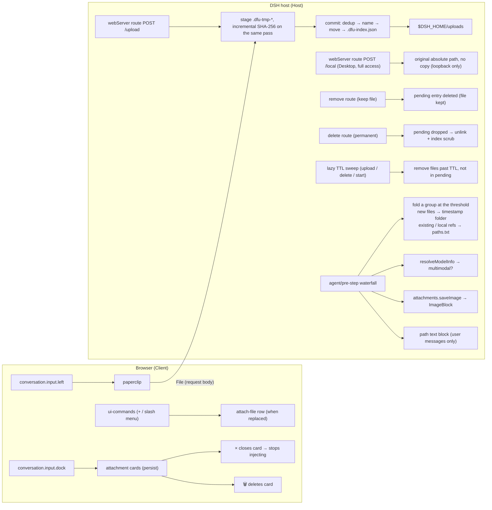

# dsh-web-file-uploader

> **🌐 Language** · [English](README.md) | [中文（简体）](README_zh_CN.md)

[](https://github.com/Mooling0602/dsh-web-file-uploader/actions/workflows/ci.yml)
[](LICENSE)
[](https://awesome-dsh-plugin.com/p/Mooling0602/dsh-web-file-uploader/)

This is a file-upload plugin developed for [DeepSeek Harness](https://github.com/deepseek-ai/deepseek-harness). It adds a [DeepSeek Web Chat](https://chat.deepseek.com) style **paperclip attach button** to the prompt input field, uploads the selected files to the **DSH host machine**, and applies **model-aware adaptation** so the files are actually readable by the running model; it also supports **content-addressed deduplication**.

It currently supports web and desktop; support for [dsh-TUI](https://github.com/ccch1mneyyy/dsh-TUI) is planned.

If you want to see the plugin's running effects, see in [Gallary](GALLARY.md).

> [!WARNING]
>
> Recently, because my npm account is still being recovered, I am unable to publish packages. If a package with the same name suddenly appears on npm, please do not download or install it!
>
> For distribution sources not supported by this project, use them at your own risk! Please report any security issues related to distribution sources in [Issues](https://github.com/Mooling0602/dsh-web-file-uploader/issues).

## Features

- 📎 Paperclip button in the composer tool row: its style basically matches the button inside DeepSeek Web Chat, with the paperclip rotated 45° to distinguish it from the official built-in feature.
- The official upload entry can be **replaced**: the shell's "Add → File" row (shared by the `+` menu and the `/` slash menu) is swapped in place for this plugin's own entry — same "File" text, but the icon uses this plugin's own angled paperclip and the command becomes `attach-file`. The standalone composer button stays visible by default and can be hidden while the replacement is on, letting the menu entry be the only upload control.
- Multi-file selection; each file is shown as a **preview-style attachment card** above the composer (images show a thumbnail): reading → uploading → saved, with copy-path and remove actions, plus a permanent delete button that appears only when a new stored copy was created (that action really deletes the file from disk).
- Once a real upload creates a new copy, it is stored on the DSH host in a directory managed by the plugin, and collected automatically by GC (garbage collection).
- Filenames are sanitized automatically (path separators, `..`, control characters rejected), and `-1`/`-2` suffixes are appended for files with the same name but different content.
- **Content-addressed deduplication**: a repeated file is referenced directly instead of being uploaded again.
- UI strings localized through the app's `locale` service (zh/en; follows the dsh web language setting or the system default)

## Usage

> This assumes you have just installed the plugin and have not changed any default setting. The plugin's settings page documents every option in detail if you want to look into them.

Click the angled paperclip button in the prompt input field and the system file picker opens; choose the files you need and confirm.

After uploading, each file is shown as a card above the prompt input field where you can adjust it. Once you press send, the cards still present are turned into file paths and injected into the text prompt, appended to the end of the user message for the model to read and analyse. Read on for more technical details.

To install this plugin right away, jump to [Installation](#installation).

## File storage location

An uploaded file copy lands in `$DSH_HOME/uploads` (default `~/.dsh/uploads`) on the DSH host.

The deduplication index (`uploads/.dfu-index.json`) lives in the same directory as the stored files.

## Model-aware adaptation & the attachment-card design

Uploaded files are shown as **attachment cards** in the dock above the composer. The cards are the source of truth for injection:

| State | Behavior |
| --- | --- |
| Card present | The file's absolute path is injected into **the user messages about to be sent**. |
| Card closed (`×`) | The file card disappears, and the uploaded copy is **kept on disk** and tracked by the plugin. |
| Card deleted (🗑) | The file card disappears, the uploaded copy is **permanently removed from the DSH host**, and the tracking index is updated accordingly. |
| Ctrl+V paste | Pasted images ride the native draft pipeline; the plugin does not interfere |

The distinction between `×` and 🗑 is intentional: `×` just stops injecting (you might want the model to find the file later), while 🗑 is a statement that you are **done with the file forever**. When the last reference is deleted, the file is removed from disk if it lives in the plugin-managed directory; if another live session still references the same deduplicated copy, the file is kept and only this session's reference is dropped.

A re-upload hits deduplication and reuses the same stored path, so such a card merely **borrows** an existing copy rather than owning it. Those cards do not show 🗑, because deleting permanently from here would also remove a file other references still use, so they keep only `×` to release the reference; for file-level deletion use the plugin's settings page, where the "in use" rule also protects files referenced by live sessions.

This is a deliberate design decision: a card **does not disappear automatically** after sending (unlike paste previews that clear on send), so you decide how long a file stays "attached" to the conversation. Each injection is one-shot (one per message), and the injected block lists exactly the files of all currently **open** cards.

Injection is distinguished by model capability:

| Model type | Image files (png/jpeg/webp/gif) | Other files |
| --- | --- | --- |
| **Multimodal** (reported `inputModalities` includes `image`) | Native `ImageBlock` via the attachments service, the image becomes part of the request like a normal attachment, with **no extra prompt text** | Path text block |
| **Text-only** (e.g. DeepSeek V4 series) | Path text block (the model can still call vision tools to parse it) | Path text block |

The capability check uses `llm.resolveModelInfo().inputModalities` (cached for 10 minutes, safe text-only fallback).

The injected prompt uses a readable, **English-only format for the model to read**:

```plaintext
-----
[Attached files] Some files have been uploaded with this message:
- /path/to/file1.txt
- /path/to/image1.png
Read the files or use tools to analyse (like vision tools), then answer the user.
```

### Compatibility with vision-tools and other plugins

- **Zero coupling**: the plugin only injects absolute paths into the prompt; it never calls, wraps, or assumes any auxiliary tool, and a tool such as vision-tools or a similar image-reading tool simply works independently once it has the path.
- **Native multimodal path**: for image-capable models, images are injected as native `ImageBlock`s, and the model can read and recognise them with its own multimodal ability.
- **Non-invasive**: injection targets only real user messages; steering / system messages are never injected, and a message that already carries the `[Attached files]` marker is never injected twice. Pasting images via Ctrl+V is handled entirely by the product's native pipeline.

## Installation

The plugin is distributed as a **static bundle**, and can currently only be installed through the prebuilt artifact on [GitHub Release](https://github.com/Mooling0602/dsh-web-file-uploader/releases) — that is, the plugin package:

```bash
# GitHub Release tarball (recommended: already built and verified)
dsh plugin --profile web add \
  https://github.com/Mooling0602/dsh-web-file-uploader/releases/download/1.0.0-rc.1/dsh-web-file-uploader-1.0.0-rc.1.tgz

# Git repository (rebuilds on install; pnpm asks to allow the build script, handle any problems yourself)
dsh plugin --profile web add github:Mooling0602/dsh-web-file-uploader

# Local directory (development; run `pnpm build` in it first, and replace `/path/to` with the actual relative or absolute path)
dsh plugin --profile web add /path/to/dsh-web-file-uploader
```

The npm channel will start with the first manual publish (see `PUBLISHING.md`); before that, use the GitHub Release tarball above.

The repository ships **sources only**: `lib/` and `client/src/client.js` are git-ignored build output, generated by `pnpm build` (and by the `prepare` script when a package is installed from git). A plain checkout has no bundle until it is built, so use the release tarball (or npm) for a ready-to-install package, or allow pnpm to run the `prepare` script for git installs. A tarball URL is pinned in the profile: switching releases means `remove` + `add` the new URL.

> **Git source format note**: pnpm's git shorthand is `github:<owner>/<repo>` (e.g. `github:Mooling0602/dsh-web-file-uploader`). A bare `github.com/<owner>/<repo>` is treated by pnpm as a *local directory* and will fail with a "non-existent directory" warning. Other valid forms: `git+https://github.com/Mooling0602/dsh-web-file-uploader.git` or `https://github.com/Mooling0602/dsh-web-file-uploader.git`.

After installing or updating, refresh the page or restart the dsh process to use it.

### Update

`dsh plugin` forwards to pnpm in the profile directory, so update through it (never edit `~/.dsh/profiles/web/node_modules` by hand — the next pnpm operation overwrites it):

```bash
# GitHub Release tarball: the URL is pinned, so switch to the new asset
# remove the plugin first, the data is not removed, so it is safe
dsh plugin --profile web remove dsh-web-file-uploader
# replace `<version>` with the latest version or a specific one you want
dsh plugin --profile web add \
  https://github.com/Mooling0602/dsh-web-file-uploader/releases/download/<version>/dsh-web-file-uploader-<version>.tgz

# git channel: re-resolve the branch and rebuild on install
dsh plugin --profile web update dsh-web-file-uploader
# or, if the lockfile-pinned resolution refuses to move:
dsh plugin --profile web remove dsh-web-file-uploader
dsh plugin --profile web add github:Mooling0602/dsh-web-file-uploader
```

Restart the dsh process after updating. For local-directory installs, run `pnpm build` in the checkout before re-adding it. Details: [PUBLISHING.md](PUBLISHING.md#update).

## Architecture



The browser never holds the bytes as base64: the `File` itself is the request body, and the host streams it to a staging file while hashing the same pass.

## Development status

- ✅ Static bundle: card-driven injection, model-aware adaptation, dedup, i18n UI, settings panel with batch delete, and the replaceable add/slash-menu entry — all covered by the test suites
- ✅ Distribution: each bare-version tag runs CI, builds the bundle and attaches the installable tarball to the GitHub Release (no build needed to install)
- ⚠️ The client build wrapper in `scripts/build.ts` is a best-effort emulation of the DSH web toolchain output; verify it against the real web build before distributing (compare with a shipped `@deepseek-ai/dsh-client-*` `lib/client.js`)

## License

MIT
