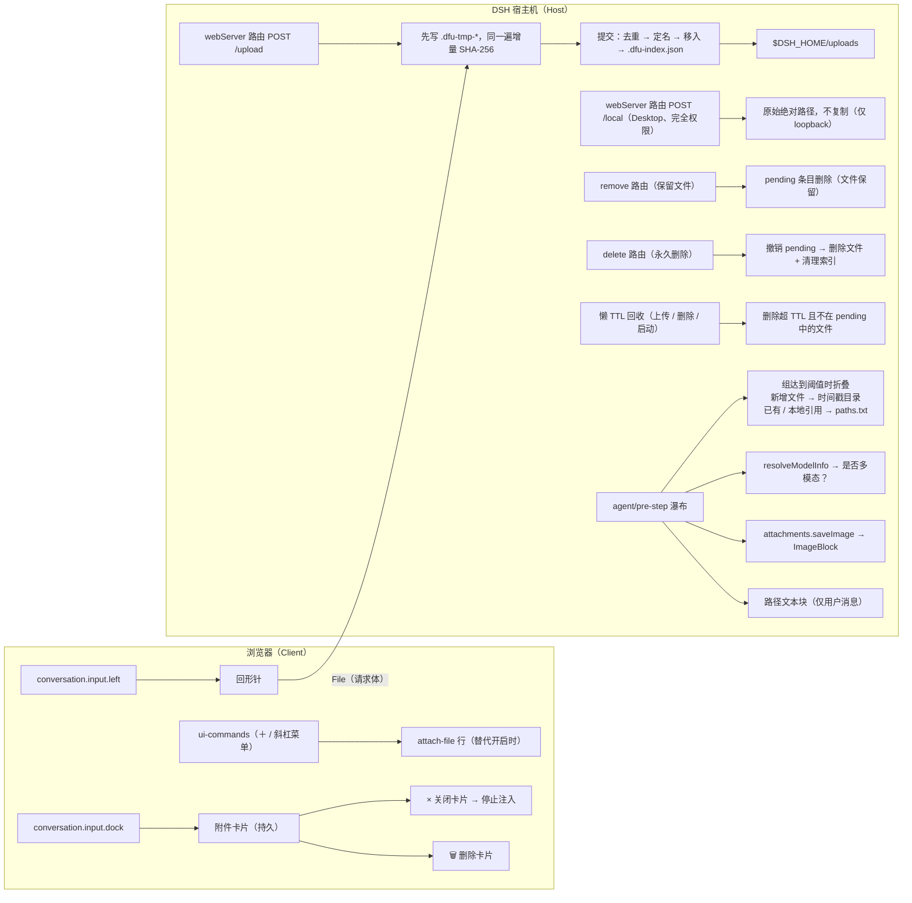

# dsh-web-file-uploader

> **🌐 语言切换** · [English](README.md) | [中文（简体）](README_zh_CN.md)

[](https://github.com/Mooling0602/dsh-web-file-uploader/actions/workflows/ci.yml)
[](LICENSE)
[](https://awesome-dsh-plugin.com/p/Mooling0602/dsh-web-file-uploader/)

这是一个为 [DeepSeek Harness](https://github.com/deepseek-ai/deepseek-harness) 开发的文件上传插件。它为提示词输入框添加了一个 [DeepSeek 网页聊天](https://chat.deepseek.com) 风格的**回形针附件按钮**，可以把选中的文件上传到 **DSH 主机**，并做了**模型感知适配**，确保文件能被正在运行的模型真正读取；此外还支持**内容寻址去重**。

目前支持 web 和桌面端，对 [dsh-TUI](https://github.com/ccch1mneyyy/dsh-TUI) 的支持正在计划中。

如果你想了解插件的运行效果，可以在 [画廊](GALLARY_zh_CN.md) 中查看。

> [!WARNING]
>
> 近期由于本人的 npm 账号仍在恢复，无法发布软件包，如果 npm 上突然出现同名软件包，请不要下载安装！
>
> 对于本项目不支持的分发源，使用它们的风险自负！请在 [Issues](https://github.com/Mooling0602/dsh-web-file-uploader/issues) 报告任何与分发源相关的安全问题。

## 功能特性

- 📎 输入框工具行里的回形针按钮：和 DeepSeek 网页聊天内的按钮样式基本一致，回形针旋转 45° 以和官方内置的功能作区分。
- 可**替代官方添加文件入口**：把 shell 的「添加 → 文件」这一项（`＋` 菜单与 `/` 斜杠菜单共用同一菜单源）原位换成插件自己的入口——文字仍是「文件」、图标用插件自己的斜向回形针样式、命令改为 `attach-file`。单独的输入框按钮默认保持显示，也可以在替代开启时隐藏，让菜单入口成为唯一上传入口。
- 支持多选；每个文件以**预览式附件卡片**显示在输入框上方（图片显示缩略图）：读取中 → 上传中 → 已保存，带"复制路径"与移除按钮，以及需要创建新的存储副本时才有的永久删除按钮（该按钮操作会实际从磁盘删除文件）。
- 文件实际上传产生新的副本后，保存在 DSH 宿主机中受插件管理的目录下，并自动 GC（垃圾清理）。
- 文件名自动清洗（拒绝路径分隔符、`..`、控制字符），为同名但内容不同的文件追加 `-1`/`-2` 后缀。
- **内容寻址防重传**：重复的文件会直接引用，不会实际上传。
- UI 文案通过应用 `locale` 服务本地化（zh/en，跟随 dsh web 语言设置或系统默认）

## 使用方法

> 这里假设你刚安装好插件，没有修改过任何默认配置。插件的配置页有详细的选项说明，你可以自行了解。

点击提示词输入框中的斜向回形针按钮，系统的文件选择器将会弹出，选择好需要的文件确认即可。

文件上传后，以卡片形式显示在提示词输入框上方，你可以进行调整。按下发送键后，还存留的文件卡片将会转换成文件路径并注入到文本提示词中，追加到用户消息末尾，以供模型读取分析。如果需要了解更多的技术细节，可以阅读下面的内容。

要直接安装此插件，请跳转阅读[安装方式](#安装方式)。

## 文件保存位置

上传的文件副本落在 DSH 主机上的 `$DSH_HOME/uploads`（默认 `~/.dsh/uploads`）。

防重传索引（`uploads/.dfu-index.json`）与存储文件在同一目录下。

## 模型感知适配与附件卡片设计

上传的文件以**附件卡片**形式显示在输入框上方的 dock 行。卡片是注入行为的唯一依据：

| 状态 | 行为 |
| --- | --- |
| 卡片存在 | 该文件的绝对路径会注入到**将发送的用户消息**中。 |
| 点击卡片 `×` 关闭 | 文件卡片消失，已上传副本**保留在磁盘**由插件追踪管理。 |
| 点击卡片 🗑 删除 | 文件卡片消失，已上传副本**将从 DSH Host 永久删除**，并同步更新追踪索引。 |
| Ctrl+V 粘贴 | 粘贴的图片走产品原生草稿管道，插件不做干预 |

`×` 与 🗑 的区分是有意为之：`×` 只是停止注入（你可能还希望模型稍后能找到该文件），而 🗑 表示你**永远不再需要这个文件**。删除最后一个引用时，如果文件在插件管理的目录下，会从磁盘彻底移除；若另一个活跃会话仍引用同一份去重副本，则保留文件、仅撤销当前会话的引用。

重复上传会命中去重、复用同一个存储路径，因此这类卡片只是**借用**已有副本、并不拥有它。这类卡片不显示 🗑 ，因为从这里永久删除会连带删掉其他引用仍在使用的文件，所以只会保留 `×` 以解除引用；文件级删除请到插件设置页进行操作，那里的「使用中」规则也会保护被活跃会话引用的文件。

这是一个**有意的设计决策**：卡片在发送后**不会自动消失**（与粘贴预览发送即清空不同），由你决定文件"附着"在对话中的时长。每次注入为一次性（每条消息一份），注入块精确列出当前所有**未关闭**卡片的文件。

注入按模型能力区分：

| 模型类型 | 图片文件（png/jpeg/webp/gif） | 其他文件 |
| --- | --- | --- |
| **多模态**（`inputModalities` 报告含 `image`） | 通过 attachments 服务注入原生 `ImageBlock`，图片成为请求的一部分，等同正常附件，**不加任何文字提示** | 路径文本块 |
| **纯文本**（如 DeepSeek V4 系列） | 路径文本块（模型仍可调用识图工具自行解析） | 路径文本块 |

值得注意的是，如果你想要图片也以纯文本路径的形式传递给原生识图模型，让模型提前处理后再进行读取，可以在插件配置页中打开“图片不注入原生管道”选项并保存。

能力检测使用 `llm.resolveModelInfo().inputModalities`（缓存 10 分钟，失败安全回退文本模式）。

注入的提示词使用可读的、**仅供模型阅读的英文格式**：

```plaintext
-----
[Attached files] Some files have been uploaded with this message:
- /path/to/file1.txt
- /path/to/image1.png
Read the files or use tools to analyse (like vision tools), then answer the user.
```

### 与识图工具等插件的兼容性

- **零耦合**：插件只把绝对路径注入提示词，从不调用、包装或假设任何辅助工具，像 vision-tools 或类似的图片识读工具拿到路径后独立工作即可。
- **原生多模态路径**：对支持图片的模型，图片以原生 `ImageBlock` 注入，模型使用自身的多模态能力即可读取并识别。
- **非侵入**：注入只针对真实用户消息，steering / 系统消息绝不会被注入；已含 `[Attached files]` 标记的消息不会重复注入。Ctrl+V 粘贴图片完全由产品原生管道处理。

## 安装方式

插件以**静态 bundle** 形式分发，目前只能通过 [GitHub Release](https://github.com/Mooling0602/dsh-web-file-uploader/releases) 预构建产物即插件包进行安装。

```bash
# GitHub Release tarball（推荐：已构建好并经过验证）
dsh plugin --profile web add \
  https://github.com/Mooling0602/dsh-web-file-uploader/releases/download/1.0.0-rc.1/dsh-web-file-uploader-1.0.0-rc.1.tgz

# Git 仓库（安装时重新构建；pnpm 会询问是否允许构建脚本，遇到问题你需要自行处理）
dsh plugin --profile web add github:Mooling0602/dsh-web-file-uploader

# 本地目录（开发用；先在目录里跑 `pnpm build`，然后将`/path/to`替换为实际的相对或绝对路径）
dsh plugin --profile web add /path/to/dsh-web-file-uploader
```

npm 渠道将从首次手动发布开始提供（见 `PUBLISHING.md`）；在此之前请使用上面的 GitHub Release tarball 安装方式。

仓库**只提交源码**：`lib/` 与 `client/src/client.js` 是 git 忽略的构建产物，由 `pnpm build`（以及安装时运行的 `prepare` 脚本）生成。刚从 clone 出来的目录没有 bundle，因此想要开箱即装的包请用 Release tarball（或 npm）；从 git 安装则需允许 pnpm 执行 `prepare` 脚本。tarball URL 会被钉在 profile 里，跨版本更新需要 `remove` 后再 `add` 新 URL。

> **Git 源格式说明**：pnpm 的 git 简写是 `github:<owner>/<repo>`（如 `github:Mooling0602/dsh-web-file-uploader`）。裸写 `github.com/<owner>/<repo>` 会被 pnpm 当作*本地目录*，报 "non-existent directory" 警告。其他合法形式：`git+https://github.com/Mooling0602/dsh-web-file-uploader.git` 或 `https://github.com/Mooling0602/dsh-web-file-uploader.git`。

安装或更新后，刷新页面或重启 dsh 进程即可使用。

### 更新

`dsh plugin` 只是把参数转发给 profile 目录下的 pnpm，因此更新也走它（不要手改 `~/.dsh/profiles/web/node_modules`——下次 pnpm 操作会直接覆盖）：

```bash
# GitHub Release tarball：URL 被钉住，需要切换到新版本资源
# 先删除当前插件，数据并不会被移除，因此请放心操作
dsh plugin --profile web remove dsh-web-file-uploader
# 把 `<version>` 换成最新的或者你想指定的版本号
dsh plugin --profile web add \
  https://github.com/Mooling0602/dsh-web-file-uploader/releases/download/<version>/dsh-web-file-uploader-<version>.tgz

# git 渠道：重新解析分支并在安装时重建
dsh plugin --profile web update dsh-web-file-uploader
# 若 lockfile 钉住的解析不肯移动，可以退回重装：
dsh plugin --profile web remove dsh-web-file-uploader
dsh plugin --profile web add github:Mooling0602/dsh-web-file-uploader
```

更新后请重启 dsh 进程。本地目录安装需要在重新 add 前先在源码目录跑一次 `pnpm build`。详见 [PUBLISHING.md](PUBLISHING.md#update)。

## 架构



浏览器不会以 base64 形式持有字节：`File` 本身就是请求体，宿主机边收边写进暂存文件，同一遍完成哈希。

## 开发状态

- ✅ 静态 bundle：卡片驱动注入、模型感知适配、防重传、i18n UI、带批量删除的设置面板，以及可替换的「添加/斜杠」菜单入口——全部由测试覆盖
- ✅ 分发：每个裸版本号标签都会跑 CI、构建 bundle，并把可安装 tarball 附加到 GitHub Release（安装端无需构建）
- ⚠️ `scripts/build.ts` 中的客户端包装器是对 DSH web 工具链产物的尽力模拟；正式分发前需对照真实 web 构建验证（与官方 `@deepseek-ai/dsh-client-*` 的 `lib/client.js` 对比）

## 许可证

MIT
